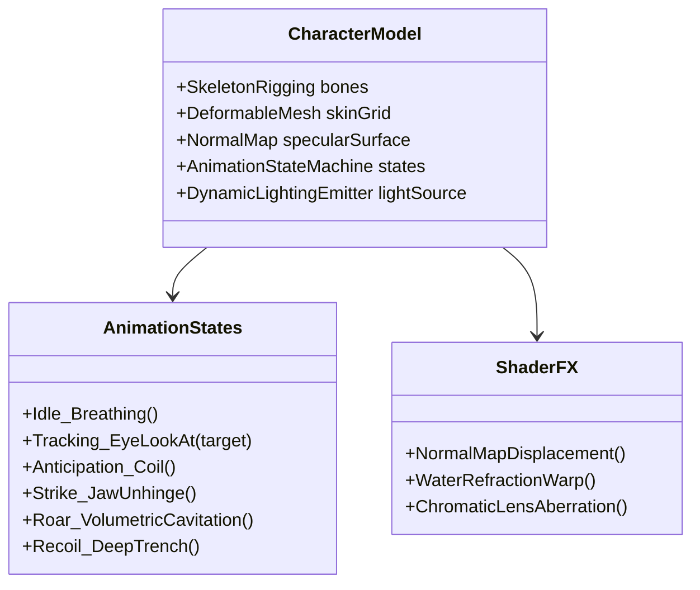

# Visual Engineering Deep-Dive: Why Modern Studio Slots Feel Visceral & How to Transform "The Descent" into a 3D Nolimit-Grade Experience

> **Objective**: Analyze the exact visual engineering gap between basic web DOM slot prototypes and industry-leading studios (**Nolimit City**, **Print Studios**, **Push Gaming**). Break down how character/creature models are built and animated, compare titles side-by-side, and outline the technical blueprint to give *The Descent: Abyssal Leviathan* true 3D visceral weight.

---

## 1. Executive Summary: The "Why It Feels Fake" Diagnosis

When you look at our current web prototype and compare it to Nolimit City's *Beheaded*, *Blood & Shadow 2*, or Push Gaming's *Razor Shark*, the intuitive reaction is immediately: **"It feels fake / flat."** 

### The Root Cause: The "Web Page" vs. "Game Engine" Divide

```mermaid
graph TD
    subgraph Current Prototype [DOM/Web Page Paradigm]
        A[HTML div Elements] --> B[CSS scale/translate transforms]
        B --> C[Static 2D image tags]
        C --> D[SVG drop-down overlays]
        D --> E[Flat, disconnected feeling]
    end

    subgraph Nolimit City [GPU WebGL/Spine Engine Paradigm]
        F[WebGL / PixiJS Shader Pipeline] --> G[2.5D/3D Skinned Mesh Rigging]
        G --> H[Normal-Mapped Dynamic Lighting]
        H --> I[Screen-Space Refraction & Fluid Shaders]
        I --> J[Visceral, tangible, cinematic depth]
    end
```



| Dimension | Web DOM Prototype (What We Have) | Nolimit City / Studio Grade (What We Need) |
| :--- | :--- | :--- |
| **Rendering Context** | HTML elements inside browser DOM (`div`, `img`, CSS) | Unified **WebGL GPU Canvas** (PixiJS / Three.js / custom shaders) |
| **Creature / Character** | Static image or 2D vector dropping over the grid | **Skinned 2.5D/3D Mesh** with skeletal bones, breathing, eye-tracking & jaw unhinging |
| **Screen Impacts** | CSS `translate(x, y)` camera jitter | **Physical Lens Refraction**, Chromatic Aberration split, and fluid displacement |
| **Symbol Behavior** | 2D tile swap with CSS opacity fade | **Physics-based squash/stretch**, specular gloss reflection sweep, and 3D tumble |
| **Atmospheric Lighting**| Static gradient overlay (`rgba(...)`) | **Normal-mapped dynamic point lights** that cast specular glints off scales & wet metal |

In a DOM-based interface, symbols, creature overlays, and backgrounds live in **separate, disconnected layers**. Your brain immediately perceives that the "jaw bite" is just a transparent image pasted over a table of squares. In a true studio slot, **everything exists within a shared physical light-and-space simulation**.

---

## 2. Side-by-Side Study of Modern Reference Slots

Let's dissect the games that set the gold standard:

### Case 1: Nolimit City's *Beheaded* (2024)
* **The Living Severed Head (Tzantza)**:
  - Mounted directly above the reels is not a static drawing, but an **active Spine2D skeletal character mesh**.
  - **Micro-movements**: It constantly breathes with subtle chest/throat contractions. The jaw twitches, tendons in the severed neck stretch and drip, and the eyes track the player's cursor and follow the reels as they spin.
  - **Emotional state morphing**: As the Progression Bar breaches Tiers 1 through 5, the head contorts from *Sad* to *Angry* to *Unhinged*, with dark smoke and glowing soul fluid erupting from its mouth and eye sockets.
* **The Soul Progression Gauge**:
  - The bar is not a CSS progress bar; it is a **volumetric glass vial shader**. As souls fly into it, fluid physics slosh with inertia, viscosity, and rising trapped bubbles.
* **The Machete & Soul Slashes**:
  - When symbols are collected, the screen doesn't just clear them: an aggressive diagonal blade cut slices through the actual reel texture, displacing the pixels on either side with a **chromatic aberration shader** (RGB channels splitting into red/cyan edges).

---

### Case 2: Nolimit City's *Blood & Shadow 1 & 2*
* **The "Shadow Girl" Metamorphosis**:
  - At the start, a mortal gothic character stands beside the reels.
  - As you progress through Ritual Tiers (Tier 0 $\to$ Tier 5):
    - **Skeletal Mesh Cross-fading**: Bones stretch; demonic curved ram horns sprout from her skull; her skin tone pales while dark cursed veins expand across her shoulders.
    - At Level 5 (The Archdemon), her eyes ignite with burning volumetric flares, skeletal wings unfurl with breathing cloth physics, and the entire altar around the reels shifts from cold candlelight to blinding hellfire.
  - **Dynamic Scene Illumination**: When she unleashes a lifeline, her burning hands cast a dynamic light cone **directly across the reel faces**, casting specular highlights on the metal borders of the symbols.

---

### Case 3: Nolimit City's *Das xBoot* (The Deep-Sea Benchmark)
* **Claustrophobic Submarine Realism**:
  - Nolimit City's deep-sea masterpiece does not treat water as a blue wallpaper.
  - **Refractive Shockwave Shaders**: When depth charges detonate, a circular water displacement normal-map ripples across the entire screen, physically warping and bending the grid tiles as if viewing through 8-inch pressurized quartz glass.
  - **Bulkhead Stress**: On high multiplier hits, the steel submarine viewport visibly flexes and bows inward, with bursting high-pressure steam jets and audible hull groans.

---

### Case 4: Push Gaming's *Razor Shark*
* **The 3D Shark Lunge & Bite**:
  - When the Great White attacks, it doesn't drop a flat jaw icon.
  - The model starts deep in the dark water background (scaled down, blurred with depth of field), coils back with a realistic predator hunting arc, and **lunges straight forward toward the player's face**, breaking through the depth plane into sharp focus.
  - The jaw snaps shut with volumetric cavitation bubbles bursting from its teeth, and it smoothly recedes back into the blue abyss.

---

## 3. The Model Anatomy: What Happens When the Character/Monster Appears

The user observed: *"when John appears the model that needs this this this we may not have it. It may not easy, but you’re already it. We need to study what makes this float so nice."*

Let's break down the exact technical components that constitute a character model like **John Ventura (San Quentin)**, **The Shadow Girl (Blood & Shadow)**, or our **Abyssal Leviathan**:



### The 5 Architectural Layers of the Model:

#### 1. Bone Hierarchy (The Skeleton Rig)
A character is not an image; it is an articulated bone structure:
- **Head & Spine Chain**: 12–18 interconnected spine bones that flex and coil like a snake.
- **Jaw Mechanics**: Upper jaw fixed to cranium, lower jaw connected via a multi-axis pivot bone that can unhinge downward and forward (like a goblin shark or viperfish).
- **Secondary Bones (Tentacles & Whiskers)**: 6–8 trailing bone chains that run on a physics spring-damping curve to produce natural underwater fluid trailing.

#### 2. Mesh Skin & Weight Painting
- Over the skeleton lies a 2.5D polygonal mesh (a triangle grid).
- Each vertex has a weight value assigned to nearby bones. When a bone rotates, the skin stretches, creases, and breathes organically without tearing or looking like cut paper.

#### 3. Normal Map & Specular Shading
- A normal map encodes the 3D surface angle (bumps, scales, fangs, wet slime) in the RGB channels.
- When an underwater light source (such as the hydrothermal vents or bioluminescent jellyfish) moves, the light glistens off the teeth, slimy gums, and chitinous scales in real 3D, creating the sensation of physical, tangible mass.

#### 4. The Animation State Machine
- **State A: Idle Stalking**: Slow sine-wave undulating motion (0.5 Hz breathing cycle). Gills flare open and close. Eyelids blink semi-randomly. Pupils subtly track reel cascade activity.
- **State B: Hunt Anticipation**: When a cascade chain starts building (2+ cascades), the creature coils backward into the trench shadows, pupil dilates, bioluminescent spines ignite from tail to head.
- **State C: The Strike Lunge**:
  1. *Acceleration*: Surges forward through the water from $Z = -400$ to $Z = +50$.
  2. *Unhinge*: Lower jaw drops open 90 degrees; throat void expands with dark vortex shader.
  3. *Clamp*: Jaws snap shut with violent deceleration, teeth locking over the target symbols.
  4. *Cavitation Shockwave*: High-pressure water bubbles and a refractive lens distortion ring blast outward across the grid.
  5. *Recoil*: Slithers back into the dark depths, leaving swirling bubbles and transformed Wild symbols in its wake.

---

## 4. The 6 Pillars of Studio-Grade Slot Visuals

```
1. UNIFIED WEBGL GPU PIPELINE
   └── PixiJS / Three.js canvas running all reels, UI, and characters together.

2. SKELETAL RIGGED CREATURES (Spine2D / Three.js SkinnedMesh)
   └── Mesh deformation, eye tracking, fluid trailing tentacles, jaw unhinging.

3. SCREEN-SPACE REFRACTION & FLUID SHADERS
   └── GLSL fragment shaders warping pixels with normal maps (water caustics, explosions).

4. 3D PERSPECTIVE CAMERA & REEL CURVATURE
   └── Reels tilted slightly in 3D perspective; camera pitches on spin and bounce stops.

5. VISCERAL SYMBOL SQUASH, STRETCH & DESTRUCTION
   └── Physics-driven velocity stretch on drops, impact squash on landings, shatter physics.

6. AUDIO-VISUAL SYNCHRONOUS COHESION
   └── Screen shake matched to sub-bass transients; lighting flashes matched to sonic peaks.
```

---

## 5. Technical Roadmap: How We Transform "The Descent"

We already have a mathematically verified, highly volatile game engine (RTP 96.03%, progressive tiers, cascading ways). To eliminate the "fake" web feeling and elevate it into a Nolimit-tier production, we execute the following technical plan:

### Phase 1: GPU WebGL Viewport Upgrade (Three.js & Custom GLSL Shaders)
* **Goal**: Replace the disconnected 2D CSS grid with a unified WebGL scene.
* **Implementation**:
  - Mount a Three.js canvas inside `#viewport-frame`.
  - Apply a custom **GLSL Water Refraction Shader** to the bathysphere viewport glass: shockwaves and bubble explosions physically bend and warp the symbols underneath.
  - Implement dynamic **Chromatic Aberration** and **Vignette Lighting** that intensifies as you descend into Levels 3, 4, and 5.

### Phase 2: The Living 3D Rigged Leviathan Creature
* **Goal**: Replace the 2D jaw SVG chomp with a genuine, living deep-sea monster.
* **Implementation**:
  - Build or import a 3D articulated Leviathan model (head, unhinging jaw, glowing lure, undulating serpent segments).
  - Position the Leviathan directly behind/above the reels in the 3D scene.
  - Hook its Animation State Machine to the game state:
    - *Idle*: Slowly undulating in the dark background, tracking spins.
    - *Anticipation*: Coiling forward with glowing bioluminescent spines when free spins or high cascades occur.
    - *Lifeline Strike*: Physically lunging forward in 3D perspective, biting down directly onto the target reel cells, releasing water cavitation shockwaves, and transmuting them to Wilds.

### Phase 3: WebGL Symbol Reels with Normal Mapping & 3D Squash/Stretch
* **Goal**: Make symbols feel like carved, heavy physical artifacts rather than flat cards.
* **Implementation**:
  - Render symbol tiles on WebGL planes with **Normal Maps** for realistic surface depth (wet stone cracks, glowing runic veins, specular highlights).
  - Implement **Velocity-based Squash & Stretch**: symbols elongate during rapid fall and compress/bounce organically upon landing on the seabed.
  - On cascade wins, symbols fracture into 3D polygonal rubble that sinks into the abyssal trench with buoyancy physics.

### Phase 4: Industrial Bathysphere Cockpit & Volumetric Lighting
* **Goal**: Give the player the feeling of standing inside a deep-sea submersible.
* **Implementation**:
  - Volumetric god rays cutting through dark water, casting moving shadows behind the reels.
  - Emergency red strobes and viewport glass stress fractures appearing dynamically during Level 5 (The Leviathan Core).
  - Audio-reactive screen shake synced with the sub-bass synthesizer for maximum physical punch.

---

## 6. Conclusion

The user's intuition is 100% correct: **a slot only feels authentic and exhilarating when the player's brain perceives real physical weight, depth, and character personality**. 

Nolimit City achieved dominance not through math alone, but by treating slot games as **interactive cinematic dark-fantasy worlds powered by GPU animation rigs and shader physics**. By adopting this same WebGL, skeletal mesh, and fluid shader architecture, *The Descent: Abyssal Leviathan* will become a truly immersive, studio-caliber masterpiece.
